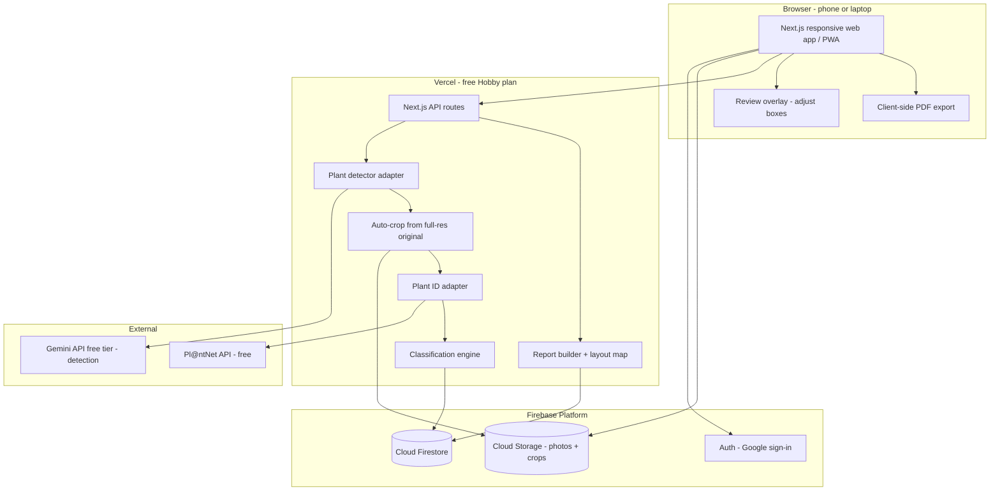
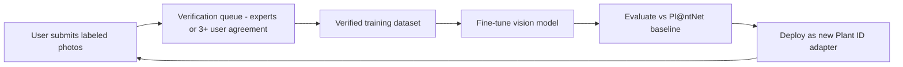

# NativeYard: Product & Technical Specification

> **Working name:** NativeYard (placeholder)
> **Version:** 0.2 (draft, decisions locked for MVP)
> **Last updated:** 2026-10-31

### Key Decisions (MVP)

| Topic | Decision |
|---|---|
| **Platform** | Responsive, mobile-friendly **web app** that works on phone and laptop (installable PWA) |
| **Pilot region** | **New Jersey only**; data model is region-agnostic so other states can be added later |
| **Plant ID** | **Pl@ntNet free API** now; later a **custom, community-trainable model** (see §16) |
| **Capture** | User uploads **one whole-yard photo**. The app **auto-detects and crops each plant** (Gemini free tier), identifies each crop, and keeps positions for a **yard layout map** in the report |
| **Pricing** | **Free** for MVP; premium features later (see §17) |
| **Sign-in** | **Google (Gmail) sign-in** only |
| **Hosting** | **Free tiers for student demo**: Firebase (App Hosting, Auth, Firestore, Cloud Storage) (see §18) |

---

## 1. Vision

Help homeowners see which plants in their yard are **native**, **non-native**, or **invasive**, starting from a few photos. Then give them a personalized, step-by-step plan to:

1. **Remove invasive plants** safely.
2. **Replace non-natives** with ecologically matched native substitutes.
3. **Add keystone native plants**, the small group of native genera that supports most of the local food web (caterpillars → birds), plus pollinators.

The app should **educate and motivate**, not shame. Every recommendation should explain *why* it helps (pollinators, birds, water, soil, less maintenance).

### 1.1 Background: Keystone Plants
Research by Doug Tallamy and the National Wildlife Federation (NWF) found that about **14% of native plant genera support about 90% of butterfly and moth caterpillar species**. Caterpillars are the main food that birds feed their young. Common keystone genera include oaks (*Quercus*), cherries (*Prunus*), willows (*Salix*), birches (*Betula*), goldenrods (*Solidago*), asters (*Symphyotrichum*), and sunflowers (*Helianthus*). Keystone lists differ by ecoregion.

---

## 2. Goals & Non-Goals

### Goals
- Identify plants from homeowner photos with a **confidence score**.
- Classify each plant's status **for the user's location**. Nativity depends on region; a plant can be native in one state and invasive in another.
- Produce a **detailed, shareable report** with removal guidance, native substitutes, and keystone recommendations.
- Teach the benefits of native pollinator gardens in plain language.
- Track progress over time (yard "Native Score").

### Non-Goals (v1)
- Professional landscape design or CAD plans.
- Plant disease or pest diagnosis.
- E-commerce (buying plants in the app). Nursery links are a later phase.
- Coverage outside **New Jersey** in the MVP (other US states next, then Canada).
- Payments / subscriptions (MVP is free).

---

## 3. Target Users

| Persona | Description | Primary Need |
|---|---|---|
| **Curious Homeowner** | Inherited a yard, can't name the plants | "What's in my yard, and is it good or bad?" |
| **Eco-Motivated Gardener** | Wants to help pollinators and birds | "What should I plant to make the most impact?" |
| **New Home Buyer** | Just moved in, planning changes | "What should I remove first? What's the plan?" |
| **HOA / Community Lead** *(later)* | Manages shared green spaces | Aggregate reports, compliance with local invasive rules |

---

## 4. Core User Flow

```mermaid
flowchart LR
    A["Onboarding: ZIP code + yard basics"] --> B["Capture / upload photos"]
    B --> C["AI plant detection and identification"]
    C --> D["User confirms or corrects IDs"]
    D --> E["Classification: Native / Non-native / Invasive"]
    E --> F["Yard Summary + Native Score"]
    F --> G["Detailed Transition Report"]
    G --> H["Action Plan and Progress Tracking"]
```



---

## 5. Functional Requirements

### 5.1 Onboarding & Location
- **FR-0** User signs in with **Google (Gmail)**. A first scan may be tried before sign-in, but saving results and reports requires sign-in.
- **FR-1** User enters ZIP code, or allows GPS, to set location.
  - **MVP:** only **New Jersey ZIP codes (07001–08999)** are supported. Out-of-state users see a "Coming soon to your state, join the waitlist" message.
- **FR-2** System resolves location to:
  - NJ County (21 counties, for local resources and county-level nativity)
  - **EPA Level III Ecoregion**. NJ has five: Northeastern Highlands, Ridge & Valley, Northern Piedmont, Middle Atlantic Coastal Plain, and Atlantic Coastal Pine Barrens
  - **USDA Hardiness Zone**: NJ is roughly 6a–7b (2023 map)
- **FR-3** Optional yard profile: sun exposure (full / part / shade), soil type (clay / loam / sand / unknown), moisture (dry / medium / wet), yard size, goals (pollinators, birds, low maintenance, food, privacy screen, erosion control).

### 5.2 Photo Capture
- **FR-4** **Primary flow: one whole-yard photo** (camera or gallery). Optionally add more wide shots for other yard zones (front, back, side), up to 5 per scan.
- **FR-5** Capture tips for wide shots: daylight, landscape orientation, stand 3–6 m (10–20 ft) from the beds, keep plants in focus, upload the **original full-resolution** photo.
- **FR-6** Allow tagging photos by yard zone (front yard, backyard, side bed, etc.).
- **FR-7** Strip EXIF GPS from stored images unless the user opts in (privacy).

### 5.3 Automatic Plant Detection & Identification
- **FR-8** **Auto-detect every plant** in the yard photo:
  - A vision model (MVP: **Gemini API free tier**) returns a bounding box and type (tree / shrub / perennial / groundcover / vine / lawn) for each distinct plant or clump.
  - The app **auto-crops each plant from the full-resolution original** and sends each crop to Pl@ntNet. **No extra photos are needed from the user.**
  - Lawn, mulch, and hardscape are labeled as areas, not sent for species ID.
  - Cap of **~15 plants per photo** to protect the daily Pl@ntNet quota. The largest and clearest plants are picked first.
- **FR-8a** **Review overlay:** show the photo with numbered boxes. The user can **adjust, delete, or add a box** (manual fallback) before or after identification.
- **FR-8b** **Close-up only when needed:** if a crop is too small (< ~250 px) or the ID confidence is low, mark that plant "Needs a closer look". The user can *optionally* add a close-up for just that plant. It is never required to get a report.
- **FR-8c** Gemini's own species guess is stored as a **second opinion**. If it disagrees with Pl@ntNet, both are shown as alternatives.
- **FR-9** For each detected plant, return:
  - Common name(s) and scientific name (genus + species, cultivar if detectable)
  - Confidence score (0–100%)
  - Top 3 alternative matches when confidence is below the threshold (e.g., < 70%)
- **FR-10** User can **confirm, correct, or mark "unknown"** for any ID. Corrections are stored and used to improve accuracy.
- **FR-11** De-duplicate the same species across photos into a single yard inventory, with a count or area estimate.

### 5.4 Native Status Classification
- **FR-12** Classify each identified species for the user's region:

| Status | Badge | Definition |
|---|---|---|
| **Native, Keystone** | 🌟 Gold | Native to the ecoregion AND on the NWF keystone list |
| **Native** | 🟢 Green | Native to the user's state or ecoregion |
| **Native to N. America (not local)** | 🟡 Light green | Native to the continent, not to the user's region |
| **Non-native, Non-invasive** | ⚪ Gray | Introduced; not known to spread aggressively |
| **Invasive** | 🔴 Red | On the state or federal invasive / noxious weed list |
| **Unknown** | ❔ | Not enough data or low ID confidence |

- **FR-13** Flag **"nativars"** (cultivars of native species). Note that some, such as those with double flowers or altered leaf color, may offer less wildlife value.
- **FR-14** Flag **legally regulated** plants (state noxious weed laws) with a link to the source.

### 5.5 Yard Summary (Instant Results)
- **FR-15** Show the plant inventory as a list or cards with photo, name, and status badge.
- **FR-16** Show the **Native Score** (0–100), calculated from:
  - % of species that are native (weighted)
  - Number of keystone species present
  - Penalty for each invasive species
  - Bonus for diversity across bloom seasons (early / mid / late)
- **FR-17** Show a quick ecological impact estimate, e.g., "Your yard currently supports ~X caterpillar species" (using genus-level Lepidoptera host counts).

### 5.6 Detailed Transition Report
Generated after the user confirms IDs. Viewable in the app and exportable as a **PDF**.

- **FR-18 Executive Summary**: Native Score, top 3 priority actions, estimated wildlife benefit.
- **FR-18a Yard Layout Map**: the original yard photo annotated with **numbered, color-coded markers** (🌟 keystone, 🟢 native, ⚪ non-native, 🔴 invasive) and a legend table (No. → plant name → status → action). Each later report section references plants by number (e.g., "#4 Burning Bush → replace with Virginia Sweetspire").
- **FR-18b Proposed Layout ("After" view)**: the same photo with markers showing *what to replace where* and suggested spots for new keystone plants. *Later / premium:* AI-generated "after" image of the yard with natives.
- **FR-19 Invasive Removal Plan**, for each invasive plant:
  - Why it's harmful (spreads into natural areas, crowds out natives, etc.)
  - Removal method (hand-pull, cut-stump, smothering, professional help)
  - Best time of year to remove
  - Disposal guidance (e.g., bag it, don't compost seeds)
  - Safety notes (sap irritation, thorns, poison-ivy look-alikes)
  - Priority: **High** (aggressive spreaders) → **Low**
- **FR-20 Native Substitute Recommendations**, for each non-native and invasive plant:
  - 2–4 native alternatives that match the **same function** (e.g., Burning Bush → Highbush Blueberry or Virginia Sweetspire for red fall color)
  - Match criteria: sun, soil, moisture, mature size, form, bloom color, evergreen vs. deciduous
  - Wildlife value of each substitute (pollinators, caterpillar hosts, bird food)
- **FR-21 Keystone Plant Recommendations**: top keystone trees, shrubs, and perennials for the ecoregion that fit the yard conditions, with host-species counts.
- **FR-22 Pollinator Garden Plan**:
  - Bloom calendar showing continuous bloom from spring to fall
  - Suggested plant groupings (plant in clusters of 3–5 or more)
  - Habitat elements: leave the leaves, bare soil for ground-nesting bees, water source, avoid pesticides
- **FR-23 Phased Timeline**:
  - *Phase 1 (Now)*: remove high-priority invasives
  - *Phase 2 (Next season)*: plant keystone trees and shrubs
  - *Phase 3 (Year 2)*: convert lawn sections or beds to native perennials
- **FR-24 Education Section**: benefits of native plants (less water, no fertilizer, support for wildlife, resilience) with short, cited explanations.
- **FR-25 Local Resources**: native plant nurseries, the state native plant society, extension office, and local invasive removal programs.

### 5.7 Progress Tracking & Engagement
- **FR-26** Save multiple scans; show Native Score history over time.
- **FR-27** Action checklist from the report; users check off completed tasks.
- **FR-28** Seasonal reminders (e.g., "Fall is the best time to plant oaks in your area").
- **FR-29** Achievements / badges (e.g., "First Keystone Planted", "Invasive-Free Yard").
- **FR-30** *(Later)* Share yard card on social media; optional NWF Certified Wildlife Habitat® guidance.

### 5.8 Plant Encyclopedia
- **FR-31** Searchable plant detail pages: photos, native range map, wildlife value, growing needs, look-alikes.

---

## 6. Data Sources

| Need | Source | Notes |
|---|---|---|
| Plant ID (image → species) | **Pl@ntNet API (free tier)** | Free account allows about 500 identifications/day for non-commercial use (check current limits). Use `project=k-world-flora` or a regional project. Send up to 5 images + organ tags per request |
| *Later:* plant ID | Custom community-trained model (§16) | Replaces or augments Pl@ntNet |
| Native range by state / county | **USDA PLANTS Database**, **BONAP** | County-level nativity |
| Keystone plants by ecoregion | **NWF Native Plant Finder / Keystone Plant lists** | Check licensing / partnership terms |
| Caterpillar host counts | NWF / Tallamy Lepidoptera host data | Genus-level |
| Invasive species lists | **EDDMapS**, state invasive species councils, **USDA Federal Noxious Weed List** | Refresh quarterly |
| Plant traits (size, sun, soil) | USDA PLANTS, **Lady Bird Johnson Wildflower Center**, Missouri Botanical Garden | For substitute matching |
| Ecoregion lookup | EPA Level III Ecoregion shapefiles | ZIP → centroid → polygon lookup |
| Hardiness zone | USDA Plant Hardiness Zone Map (2023) | ZIP-based |
| Nurseries | Audubon Native Plants DB, state native plant societies | Phase 2 |

### 6.1 New Jersey Data Sources (MVP)

| Need | NJ Source |
|---|---|
| NJ invasive plant list | **NJ Invasive Species Strike Team** (Friends of Hopewell Valley Open Space), **NJDEP** invasive plant regulations / sales ban list, **Mid-Atlantic Invasive Plant Council** |
| NJ native plant lists | **Native Plant Society of New Jersey**, **Jersey-Friendly Yards** plant database (Barnegat Bay Partnership / Rutgers), USDA PLANTS (NJ county distribution) |
| Growing guidance & local help | **Rutgers Cooperative Extension** (county offices, Master Gardeners) |
| Pine Barrens specifics | NJ Pinelands Commission native plant lists |
| Keystone plants | NWF keystone list for the Mid-Atlantic / Northeast ecoregions |

### 6.2 NJ Seed Data (MVP Scope)
Rather than all ~2,000+ NJ plants, start with a **curated set of about 150–250 species** commonly found in NJ yards:
- **~40 common invasives**, e.g., Japanese barberry, burning bush, Norway maple, Callery (Bradford) pear, English ivy, Japanese honeysuckle, porcelain berry, multiflora rose, tree-of-heaven, Japanese knotweed, privet, autumn olive, Japanese stiltgrass, wineberry.
- **~60 common non-native ornamentals**, e.g., hostas, boxwood, hydrangea macrophylla, azalea hybrids, lawn grasses, daylilies.
- **~100 NJ natives, with keystones flagged**, e.g., oaks (white, red, pin, swamp white), black cherry, red maple, river birch, willows, serviceberry, highbush blueberry, Virginia sweetspire, inkberry, goldenrods, New England / aromatic asters, wild bergamot, butterfly weed, swamp milkweed, mountain mint, black-eyed Susan, little bluestem.
- Each invasive / non-native maps to **2–4 NJ native substitutes**.
- Plants not in the curated set still show the Pl@ntNet name with an "Unknown status" badge. They are queued for curation.

> ⚠️ **Licensing:** Confirm terms of use for every dataset and API before launch. NWF and Audubon data may require partnership agreements. Pl@ntNet's free tier is **non-commercial**; switch to a paid plan or the custom model before monetizing.

---

## 7. System Architecture



Two swappable interfaces:
- **Plant detector adapter** `detect(image) → [{box, type, guess}]`: Gemini now; later the custom model or an open-source detector (e.g., Grounding DINO / OWLv2).
- **Plant ID adapter** `identify(images, organs) → candidates[]`: Pl@ntNet now; later the custom model.

### 7.1 Stack (MVP, all free tier)
- **Frontend:** Next.js (App Router, React 19), responsive mobile-first CSS, camera capture via `<input type="file" accept="image/*" capture>` and desktop live webcam.
- **Backend:** Next.js API routes on Firebase App Hosting / Cloud Run.
- **DB:** Firebase Cloud Firestore (plant knowledge base, properties, yard areas, scan histories).
- **Storage:** Firebase Cloud Storage with client-side WebP compression (max 1280px).
- **Auth:** Firebase Auth with Google One-Click Provider (Gmail sign-in).
- **PDF:** generated in the browser via `jsPDF` and `html2canvas`.
- **Report narrative:** template-based in the MVP; Gemini 2.5 Flash for personalized summaries.
- **Hosting:** Firebase App Hosting & Hosting (see §18).

### 7.2 Identification Pipeline
1. **Upload** the whole-yard photo (client-compressed WebP) → Firebase Cloud Storage.
2. **Detect:** send a downscaled copy (~1600 px) to Gemini with a structured prompt: *"Return JSON of every distinct plant: box_2d [ymin, xmin, ymax, xmax] normalized 0–1000, type, best-guess name."* Lawn and hardscape come back as areas.
3. **Auto-crop:** map the normalized boxes back to the **full-resolution** image, add ~10% padding, and crop server-side (e.g., `sharp`). Skip crops below the minimum size and mark them "Needs a closer look".
4. **Identify:** send each crop to Pl@ntNet `/v2/identify` in **parallel** (organ = `auto`, or `leaf` / `flower` if Gemini reports it). Cache by image hash.
5. **Confidence check:** if the top score < 0.5, the top 2 are close, or Gemini disagrees, show the top 3 alternatives and ask the user to confirm.
6. **Normalize:** map the name to a canonical taxon ID (USDA symbol) in the knowledge base.
7. **Classify:** look up nativity, invasive status, and keystone status for the user's region.
8. **Layout:** save each plant's box with its result so the report can draw the numbered, color-coded **yard layout map**.

**Timing (free tier):** detection ~3–8 s, plus ~15 parallel Pl@ntNet calls ~3–6 s. This fits within Vercel Hobby function limits. If needed, split it into two API calls (`/detect` then `/identify`) so the user sees boxes while IDs load.

**Accuracy trade-off:** plants in a wide shot are smaller than in close-ups, so accuracy per plant is lower. Mitigations: crop from the full-res original, a minimum crop size, a Gemini second opinion, optional per-plant close-ups only where flagged, and user confirmation.

### 7.3 Report Generation
- Structured facts (status, substitutes, removal methods) come from the **curated knowledge base**, not invented by the LLM.
- The LLM is used only for **narrative text** (personalized summary, explanations), grounded in the retrieved facts.
- All plant claims link to a source.

---

## 8. Data Model (Core Entities)

```
User            (id, email, name, created_at)
Property        (id, user_id, zip, lat, lng, state, county, ecoregion_l3, hardiness_zone,
                 sun, soil, moisture, size_sqft, goals[])
Scan            (id, property_id, created_at, status, native_score)
Photo           (id, scan_id, url_original, url_display, zone_tag, width, height)
Detection       (id, photo_id, marker_no, bbox_norm[ymin,xmin,ymax,xmax], plant_type, crop_url,
                 source[auto|manual], detector_guess, taxon_id, confidence, alternatives[],
                 needs_closeup, closeup_url, user_confirmed, user_corrected_taxon_id)
YardPlant       (id, scan_id, taxon_id, count_estimate, zones[])         -- de-duplicated inventory
Taxon           (id, usda_symbol, scientific_name, common_names[], genus, family, growth_habit,
                 traits{sun, moisture, soil, height, bloom_months, evergreen})
RegionalStatus  (taxon_id, region_type, region_code, status, source, updated_at)
                 -- status: native | introduced | invasive | noxious
KeystoneEntry   (taxon_or_genus, ecoregion_l2, lep_host_count, source)
Substitute      (target_taxon_id, substitute_taxon_id, ecoregion, function_tags[], rationale)
RemovalGuide    (taxon_id, methods[], best_season, disposal, safety_notes, priority)
Report          (id, scan_id, generated_at, pdf_url, json_payload)
ActionItem      (id, report_id, title, phase, due_season, completed_at)
```

---

## 9. API Endpoints (v1)

| Method | Endpoint | Purpose |
|---|---|---|
| POST | `/api/properties` | Create property from ZIP / yard profile |
| POST | `/api/scans` | Start a new scan |
| POST | `/api/scans/:id/photos` | Upload photos |
| POST | `/api/scans/:id/analyze` | Run ID + classification (async) |
| GET | `/api/scans/:id` | Scan status, detections, inventory, Native Score |
| PATCH | `/api/detections/:id` | Confirm or correct an ID |
| POST | `/api/scans/:id/report` | Generate detailed report |
| GET | `/api/reports/:id` / `.pdf` | View or download report |
| GET | `/api/plants/:taxonId?region=` | Plant detail + regional status |
| GET | `/api/recommendations?property=` | Keystone and pollinator picks |
| PATCH | `/api/action-items/:id` | Mark task complete |

---

## 10. Key Screens

1. **Landing page**: value proposition, sample report, "Scan My Yard" CTA.
2. **Onboarding**: ZIP + yard conditions (3 quick steps).
3. **Capture**: camera / upload with tips overlay.
4. **Analyzing**: progress animation with native-plant facts.
5. **Results**: photo with color-coded plant markers + inventory list + Native Score dial.
6. **Plant Detail sheet**: status, why it matters, substitutes / removal.
7. **Report**: tabbed sections (Summary · Remove · Replace · Add Keystones · Pollinator Plan · Timeline) + PDF export.
8. **My Yard Dashboard**: score history, checklist, seasonal tips.

**Design tone:** warm, nature-inspired (greens, earth tones, wildflower accents), encouraging language. Use "opportunity to improve" instead of "bad plant".

---

## 11. Non-Functional Requirements

| Area | Requirement |
|---|---|
| **Performance** | Instant results within 30 seconds for up to 10 photos; report within 60 seconds |
| **Accuracy** | ≥ 85% top-1 genus accuracy on common landscape plants; always show confidence |
| **Accessibility** | WCAG 2.1 AA; status shown by icon + text, not color alone |
| **Privacy** | Photos private by default; delete-my-data option; no location shared publicly |
| **Cost control** | Cache ID results by image hash; rate-limit free tier |
| **Data freshness** | Invasive lists refreshed quarterly |
| **Disclaimers** | IDs are AI-assisted; confirm before removing; consult local experts for toxic or regulated plants |

---

## 12. Success Metrics

- % of users who complete a scan → view report (target 60%+)
- % of IDs confirmed without correction (accuracy proxy)
- Avg. Native Score improvement between first and 6-month rescan
- Number of action items completed (invasives removed, keystones planted)
- Report PDF downloads / shares

---

## 13. Release Roadmap

| Phase | Scope |
|---|---|
| **MVP (v0.1): NJ demo** | Google sign-in, NJ ZIP onboarding, photo upload + crop, Pl@ntNet ID with confirm / correct, native / non-native / invasive / keystone classification (curated NJ set), yard summary + Native Score, basic report (removal + NJ substitutes + keystone list), browser PDF export. Hosted free on Firebase (App Hosting, Auth, Firestore, Cloud Storage) |
| **v0.2: NJ complete** | Native Score history, action checklist, pollinator bloom calendar, county-level resources (Rutgers Extension, NPSNJ chapters), expand curated set to 500+ species |
| **v0.3: Community data** | "Contribute photos" flow, neighborhood plant map, expert verification queue (foundation for the custom model) |
| **v0.4: Custom model** | Train and deploy the first custom NJ yard-plant model; A/B test against Pl@ntNet |
| **v1.0: Multi-state + Premium** | Add neighboring states (NY, PA, DE, CT), premium tier (§17), badges, social sharing |
| **Future** | Native mobile apps, AR overlay ("see your yard with natives"), HOA / municipal dashboards, nursery partnerships, Canada |

---

## 14. Risks & Mitigations

| Risk | Mitigation |
|---|---|
| Misidentification leads to wrong removal | Confidence thresholds, user confirmation step, "verify before removing" warnings, look-alike notes |
| Nativity is region-specific and complex | County / ecoregion-level data from USDA / BONAP; show source |
| LLM hallucinating plant facts | Facts come from the curated KB only; LLM writes narrative from retrieved data |
| Data licensing restrictions | Early outreach to NWF, Audubon, Wildflower Center; fall back to public-domain USDA data |
| Pl@ntNet free quota (~500/day) exceeded during a demo | Cache by image hash, per-user daily limit (e.g., 20 IDs), friendly "try again tomorrow" message |
| Free-tier limits (storage caps, Cloud Run quotas) | Open the app before demos; WebP client-side canvas compression; auto-delete anonymous scans after 7 days |
| Pl@ntNet free tier is non-commercial | Move to the paid Pl@ntNet plan or the custom model before launching paid features |
| Poor-quality community training images | Expert / multi-user verification before images enter the training set |
| Winter / dormant plants are hard to ID | Suggest rescanning in growing season; allow bark / twig photos |

---

## 15. Decisions & Remaining Open Questions

### Resolved
| # | Question | Decision |
|---|---|---|
| 1 | Platform | Mobile-friendly responsive web app (PWA), phone + laptop |
| 2 | Pilot region | New Jersey |
| 3 | Plant-ID provider | Pl@ntNet free API → custom community-trained model later |
| 4 | Monetization | Free now; premium tier later |
| 5 | Accounts | Google (Gmail) sign-in; try one scan before sign-in, sign in to save |

### Still Open
1. **Partnerships:** Approach Native Plant Society of NJ, Rutgers Extension, Jersey-Friendly Yards for data and credibility?
2. **App name & branding:** keep "NativeYard" or choose another?
3. **Data curation owner:** who reviews and maintains the NJ plant / substitute list?

---

## 16. Future: Custom Community-Trainable Plant Model

**Goal:** a plant-ID model tuned to the plants commonly found in **local neighborhoods**, improved by users who contribute labeled photos.

### 16.1 How It Works


### 16.2 Approach
- **Model type:** an image **vision model** (not a text LLM). Options:
  - *Phase A (cheap, fast):* **embedding + nearest-neighbor** (e.g., CLIP / DINOv2 image embeddings stored via Firestore Vector Search / Vertex AI). New plants can be added just by uploading example images, no retraining needed. Good fit for "user trains by providing images".
  - *Phase B (accurate):* **fine-tuned classifier** (e.g., EfficientNet / ViT) trained on the verified dataset. Train on Google Colab or Kaggle (free GPUs); serve via Hugging Face Inference or a small GPU host.
  - *Optional:* multimodal LLM (e.g., Gemini) for explanations and multi-plant detection.
- **Hybrid inference:** custom model first. If confidence is low, fall back to Pl@ntNet.
- **Data features:**
  - "Teach the app" screen: upload 5–20 photos of a plant + species name + organ tags
  - Neighborhood / ZIP tagging, so models can weight locally common species
  - Verification badges for trusted contributors (Master Gardeners, NPSNJ members)
  - Clear consent: contributed images licensed (e.g., CC BY) for training
- **Data model additions:** `TrainingImage (id, user_id, taxon_id, organ, zip, license, status[pending|verified|rejected], verified_by)`, `ModelVersion (id, type, metrics, deployed_at)`.

---

## 17. Future: Monetization (Premium Features)

The MVP is **free**. Candidate premium features for later:

| Free | Premium (later) |
|---|---|
| Plant ID + native status | Unlimited scans and IDs |
| Basic report | **Advanced report**: yard layout plan, planting quantities, cost estimates, branded PDF |
| 1 property | Multiple properties (landlords, landscapers) |
| Keystone list | **Personalized garden design** (AI layout over the yard photo / AR preview) |
| Checklist | Seasonal coaching emails and SMS reminders |
| | **Pro / Landscaper tier**: client reports with own logo |
| | **HOA / Municipal tier**: community dashboards, invasive maps |
| | Nursery partner discounts / affiliate links |

> Before charging: move off Pl@ntNet's non-commercial free tier, upgrade Vercel to Pro (Hobby is non-commercial), and add payments (e.g., Stripe).

---

## 18. Hosting: Free Options for a Student Demo

### 18.1 Recommended Setup ($0)

| Layer | Service | Free tier highlights* | Why |
|---|---|---|---|
| **Web app + API** | **Firebase App Hosting / Cloud Run** | Next.js 16 SSR & API routes, automatic HTTPS, GitHub auto-deploys | Native Google Cloud integration; zero config |
| **Custom Domain & CDN** | **Firebase Hosting** | Free SSL, global fast CDN rewrites (`https://njnativeyard.web.app`) | Fast edge distribution with custom domain options |
| **DB + Auth + Storage** | **Firebase (Spark Plan)** | Cloud Firestore (1 GiB, 50k reads/day), Firebase Auth (Google sign-in), Cloud Storage (5 GB free) | Single unified Google ecosystem for auth, data, and photos |
| **Plant ID** | **Pl@ntNet API** | ~500 IDs/day, non-commercial | Free, botanically trustworthy |
| **Plant detection** | **Google Gemini API** free tier (API key from Google AI Studio) | Rate-limited free usage | Finds and boxes each plant in the whole-yard photo; also report narrative |
| **Code + CI** | **GitHub** (free) | Repos, Actions | Firebase App Hosting deploys on each branch push |

\*Free-tier limits change; check the current pricing pages before relying on them.

**Student perks:** the **GitHub Student Developer Pack** includes free credits and offers (e.g., a free domain, cloud credits, and other services) useful when the demo outgrows free tiers.

### 18.2 Free-Tier Gotchas
- **Client-Side Image Compression:** Use `compressImageToOptimizedBlob()` (max 1280px, WebP ~100KB) to ensure 40,000+ photos fit comfortably inside the 5 GB Spark free tier.
- **Google OAuth:** Configure authorized domains in Firebase Authentication settings (e.g., `njnativeyard.web.app`, `localhost`).
- **Cloud Run Ingress:** For Firebase Hosting rewrites to App Hosting services, ensure `roles/run.invoker` is granted to `allUsers`.
- Keep API keys (Pl@ntNet, Gemini) **server-side only** in `.env.local` or Cloud Run environment variables.

---

## 19. Visual Plant Matcher & Local Botanical Image Database (v0.3)

To ensure homeowners can accurately identify plants without guessing from text alone:
- **Local Botanical Asset Cache (`/public/plants/*.jpg`):** 185+ high-resolution, open-access botanical photos populated locally for all major New Jersey landscape species (invasive thicket shrubs, ornamentals, keystone canopy trees, and pollinator perennials).
- **Suggestion Visual Cards:** The manual matcher modal presents full-color photo cards of suggested similar species matching the plant's detected growth form (shrub, tree, flower) with color-coded ecological badges (**Green** / **Orange** / **Red**).
- **Visual Inventory:** Identified plants in the yard report and the searchable 150+ plant database list display corresponding plant thumbnails alongside botanical and common names.
- **Instant Local Delivery:** All plant images are hosted within Next.js static assets for sub-millisecond offline/local rendering without external API image latency or broken links.

---

## 20. Close-Up (Macro) Visual Leaf Matcher (v0.4)

When wide-angle yard photos have insufficient resolution to distinguish subtle botanical species:
- **Multi-Scale Vision Pipeline:** Wide photo maps the yard and places bounding boxes; unverified or ambiguous plants prompt the homeowner to take or upload a high-resolution close-up photo (leaf, flower, or twig).
- **Macro Vision Diagnostics (`/api/identify-macro`):** Runs Gemini Vision with a botanical taxonomic prompt to extract morphological traits:
  - Leaf Type (Simple broadleaf, Compound, Needle-like)
  - Margin structure (Entire/smooth, Serrated/toothed, Lobed, Spiny)
  - Arrangement (Alternate, Opposite, Whorled)
  - Observable field markers (Thorns/spines, fuzzy underside, gland-tipped teeth)
- **Side-by-Side Visual Comparison Modal:** Homeowner's close-up photo is displayed on the left alongside the top candidate lookalikes on the right with:
  - High-resolution local botanical reference photos
  - Key distinction callout box explaining the exact leaf difference to look for
  - Native / Invasive / Keystone status badge
  - One-click confirmation to verify the plant and instantly update the yard score and transition report.
